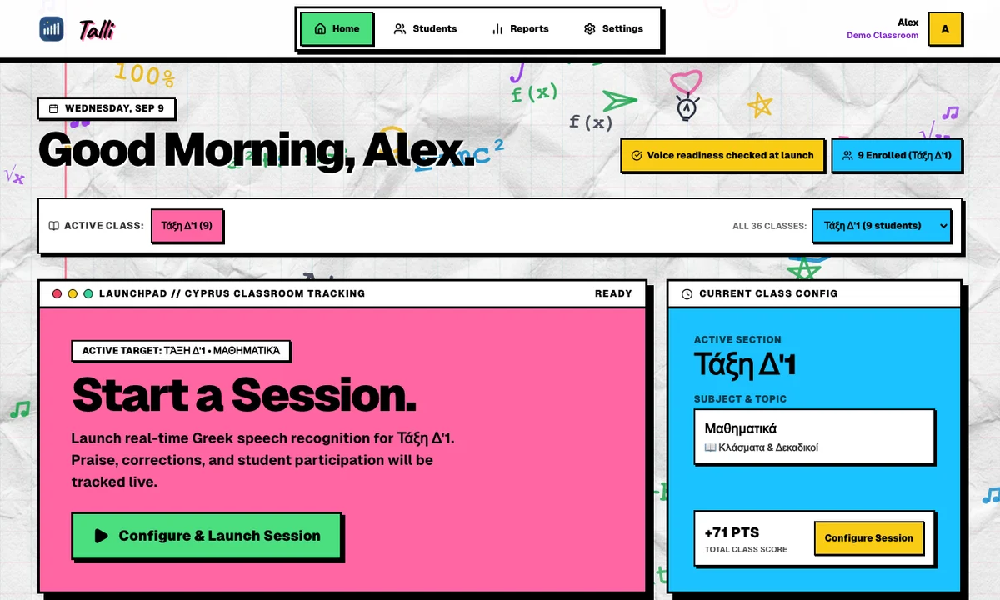

<!--
THESIS: A developer notebook grounded in Elias's projects and real screenshots.
OWN-WORLD: Native GitHub reading surface, purple nameplate, plain prose and generous section breaks.
STORY: Meet Elias, understand two projects, browse other work, get in touch.
FIRST VIEWPORT: Compact nameplate, introduction, contact links, and the first project; no promotional hero.
FORM: Developer notebook, grounded candidate 1, user-selected; seed 80180cbe. Static Markdown; project links are the interaction.
FINISH: unreviewed and undocumented is unfinished; this build ends with the finish review, the verdict, DESIGN.md, and every shipping raster carrying its provenance
-->

<h1></h1>

I'm **Qu4rk**. I build AI tools, web applications, and the occasional mobile app. My projects range from prompt caching to a classroom tool that understands spoken Greek.

[Portfolio](https://qu4rk.github.io/QuarkMade/) · [Email](mailto:liasides.elias@gmail.com) · [All repositories](https://github.com/Qu4rk?tab=repositories)

## A couple of projects

### [Talli](https://github.com/Qu4rk/Talli)

A classroom tool for primary school teachers in Cyprus. It turns spoken Greek praise and corrections into student points, and sends uncertain cues to the teacher for review.

Application screenshot with fictional student data. <a href="./assets/readme/talli.webp">View full size</a>.

Built with TypeScript, Next.js, Deepgram, and Silero VAD.

### [CacheSnipe](https://github.com/Qu4rk/CacheSnipe)

An OpenCode plugin for DeepSeek prompt caching. It keeps repeated prompt prefixes stable and tracks cache hits, prefix breaks, and token costs, so you can see what gets reused and what changes between turns.

Written in TypeScript. [Read the code and setup instructions](https://github.com/Qu4rk/CacheSnipe).

## Other work

- **[Lumina Living](https://www.lumina-living.net/)** — A website for a coastal property in Cyprus, built with Next.js, React, and GSAP. [Source](https://github.com/Qu4rk/LuminaLiving).
- **[BuildEffortless](https://github.com/Qu4rk/build_effortless)** — A Flutter app for planning PC builds, comparing components, and saving configurations in SQLite.
- **[Chronotomi Wealth](https://www.chronotomi.com/)** — A website for timepieces and private advisory. [Source](https://github.com/Qu4rk/chronotomi-wealth).

## Tools I use

TypeScript, React, and Next.js for web projects; Python for AI work; Flutter and Dart for mobile apps. I also work with SQL, C#, Docker, and Kubernetes.

You can find more of my work at **[QuarkMade](https://qu4rk.github.io/QuarkMade/)**, or reach me at **[liasides.elias@gmail.com](mailto:liasides.elias@gmail.com)**.
